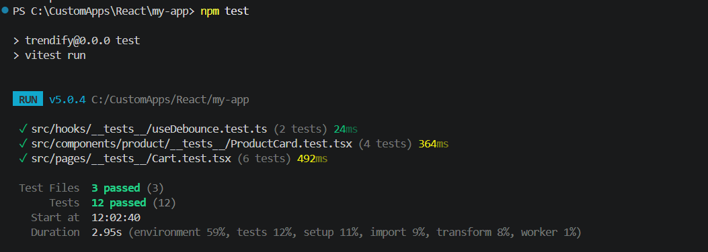
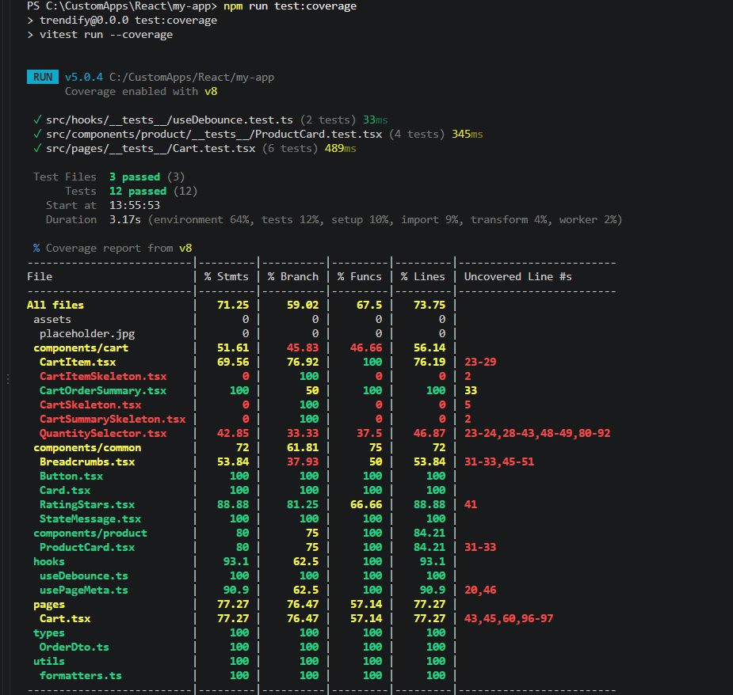

# Trendify E-Commerce Storefront

A modern, high-performance E-Commerce storefront built with **React 19, TypeScript, Vite, Tailwind CSS v4, and React Router**. The application connects to an ASP.NET Core Web API backend to deliver a complete online shopping experience including product discovery, live filtering/searching, cart management, user authentication, multi-step checkout, and order history tracking.

---

## Table of Contents
1. [Tech Stack & Architecture](#tech-stack--architecture)
2. [Folder & Project Structure](#folder--project-structure)
3. [End-to-End Application Flows](#end-to-end-application-flows)
   - [Authentication Flow](#1-authentication-flow)
   - [Product Search & Filtering Flow](#2-product-search--filtering-flow)
   - [Cart Management Flow](#3-cart-management-flow)
   - [Checkout Flow](#4-checkout-flow)
   - [Orders & Order Details Flow](#5-orders--order-details-flow)
4. [Pages & Component Architecture](#pages--component-architecture)
5. [Custom Hooks Explained](#custom-hooks-explained)
6. [Performance Optimization (Assignment 20)](#performance-optimization-assignment-20)
   - [Before vs. After Comparison](#before-vs-after-performance-comparison)
   - [Detailed Optimizations Implemented](#detailed-optimizations-implemented)
7. [Testing & Coverage Report (Assignment 22)](#testing--coverage-report-assignment-22)
8. [Getting Started & Available Scripts](#getting-started--available-scripts)

---

## Tech Stack & Architecture

- **Frontend Core**: React 19, TypeScript, Vite
- **Styling**: Tailwind CSS v4 (`@tailwindcss/vite`) with custom theme tokens
- **Routing**: React Router DOM (v7) with route-level lazy loading (`React.lazy` + `Suspense`)
- **State Management**: React Context API (`AuthContext`, `CartContext`, `OrderContext`) + `useReducer`
- **Network Layer**: Fetch API with custom interceptors for token injection, 401 automatic refresh, and error handling
- **Testing**: Vitest + React Testing Library + V8 Coverage

---

## Folder & Project Structure

Anyone exploring this repository can easily find what they are looking for by understanding the folder organization:

```
my-app/
├── public/                 # Static public assets
├── src/
│   ├── assets/             # Bundled images and icons (e.g., placeholder.jpg, hero.png)
│   ├── components/         # Reusable UI components grouped by business feature
│   │   ├── auth/           # Authentication guards (ProtectedRoute)
│   │   ├── cart/           # Cart components (CartItem, CartOrderSummary, QuantitySelector, Skeletons)
│   │   ├── checkout/       # Multi-step checkout components (AddressCard, AddressFormSection, Steps)
│   │   ├── common/         # Generic shared primitives (Button, Card, RatingStars, Breadcrumbs, ErrorBoundary, StateMessage)
│   │   ├── layout/         # Shell components (Header, Footer, SharedLayout, ScrollToTop)
│   │   ├── orders/         # Order listing components (OrderCard, OrderStatusBadge, OrderDetailsExpanded)
│   │   └── product/        # Catalog components (ProductCard, ProductGrid, FilterSidebar, ProductSearch)
│   ├── contexts/           # Global React Context providers (AuthContext, CartContext, OrderContext)
│   ├── hooks/              # Custom reusable hooks (useCart, useAuth, useDebounce, useFetch, useProductFilters, useOrders, usePageMeta)
│   ├── pages/              # Top-level route pages (Home, ProductListing, ProductDetail, Cart, Checkout, Orders, Login, NotFound)
│   ├── services/           # API interaction modules (api.ts, authApi.ts, cartApi.ts, orderApi.ts, productApi.ts, locationApi.ts)
│   ├── styles/             # Global CSS and Tailwind configuration
│   ├── test/               # Vitest environment setup and mock configuration
│   ├── types/              # TypeScript interfaces, DTOs, and request/response models
│   ├── utils/              # Helper utilities (formatters, token storage, URL helpers, api adapters)
│   ├── App.tsx             # Root routing layout and Context provider tree
│   ├── config.ts           # Base API URL configuration
│   └── main.tsx           # React DOM root entrypoint
├── package.json            # Dependencies and npm scripts
├── tsconfig.json           # TypeScript configuration
└── vite.config.ts          # Vite build and Vitest configuration
```

---

## End-to-End Application Flows

Here is how the main user journeys are handled across the application:

### 1. Authentication Flow
- **Login / Register**: The user enters their email and password on `/login`. The form calls `loginApi()` in `services/authApi.ts`.
- **Token Management**: The API returns an access JWT, a refresh token, and user profile data. `AuthContext` stores tokens securely in `localStorage` through `utils/token.ts` and updates the React user state.
- **Header Injection & Auto-Refresh**: Every subsequent HTTP request sent through `services/api.ts` automatically attaches `Authorization: Bearer <token>`. If an endpoint returns HTTP `401 Unauthorized`, `api.ts` automatically intercepts the failure, calls `/api/auth/refresh` behind the scenes, saves the new access token, and retries the original request seamlessly.
- **Route Protection**: When an unauthenticated user tries to visit `/cart`, `/checkout`, or `/orders`, the `ProtectedRoute` component intercepts the navigation, saves their current location in history state, and redirects them to `/login`. Upon successful login, they are sent right back where they were trying to go.

### 2. Product Search & Filtering Flow
- **URL as Single Source of Truth**: When users type a search term, pick a category, check a brand, or move the price slider, `useProductFilters` synchronizes these choices directly with the browser URL search parameters (`?Search=...&CategoryId=...&MinPrice=...`).
- **Debounced Search**: Typing in the search bar does not spam the backend. The input updates local state for instant typing feel, while `useDebounce(..., 300)` waits 300ms after the user stops typing before syncing to the URL and firing the backend search request.
- **Server-Side Filtering**: `productApi.searchProducts()` takes these parameters, builds a clean query string, and requests `/api/v1/Products/search`. The response includes paginated products, total pages, and record counts.
- **Catalog Navigation**: Clicking any product navigates to `/products/:id`. `productApi.getProductById(id)` queries `/api/v1/Products/${id}` directly and maps the DTO into the UI model.

### 3. Cart Management Flow
- **Adding Items**: A user clicks "Add to Cart" on a `ProductCard` or on the `ProductDetail` page. If they are not logged in, they are politely prompted to log in first.
- **Cart Context & Reducer**: `addToCart` dispatches an `ADD_ITEM` action to `CartContext`'s reducer. It immediately updates the local state for a fast UI response, saves the cart to `localStorage`, and calls `cartApi.addCartItem()` to persist it on the backend.
- **Separated Contexts**: Cart state is split into `CartStateContext` (the data) and `CartActionsContext` (the action functions). Components that only need to trigger actions (like `ProductCard`) do not re-render every time another product is added.
- **Quantity Adjustments**: Inside `/cart`, users can increment, decrement, or type a custom quantity with `QuantitySelector`. Quantity validation prevents numbers below 1.

### 4. Checkout Flow
- **Step 1: Shipping Address**:
  - Displays saved user addresses using `AddressCard`.
  - Allows selecting an existing address or filling out a new one with `AddressFormSection`.
  - Address fields validate required inputs, postal code patterns, and 10-digit phone numbers.
- **Step 2: Delivery & Shipping Method**:
  - Users select Standard, Express, or Same-Day delivery. Shipping rates update the order total in real-time.
- **Step 3: Payment Selection**:
  - Supports Cash on Delivery (COD), Credit/Debit Card, and UPI.
- **Step 4: Review & Place Order**:
  - `ReviewStep` summarizes items, shipping destination, and payment method.
  - Submitting calls `orderApi.checkout()`, creating the order in the backend database.
  - `CartContext.clearCart()` empties the active cart, and the user is redirected to the `/orders` page with a confirmation toast.

### 5. Orders & Order Details Flow
- **Order History**: The `/orders` page displays past orders fetched through `orderApi.getOrderHistory()`.
- **Filtering by Status**: Tab buttons (`All`, `Processing`, `Shipped`, `Delivered`, `Cancelled`) filter the displayed orders instantly on the client.
- **View Order Details**: Clicking an order card fetches `/api/v1/Orders/${id}` and expands to reveal shipping destination, price breakdown, and individual purchased items.
- **One-Click Reorder**: Clicking "Reorder" sends a request to the backend reorder endpoint, adds all items from that past order back into the active cart, updates the cart badge counter, and displays a success notification.

---

## Pages & Component Architecture

| Page Route | Key Components Used | What It Does |
| :--- | :--- | :--- |
| `/` | `Hero`, `FeaturedProductCarousel`, `ShopByCategory`, `ServiceHighlights` | Landing page showing store branding, top categories, and carousel of featured items. |
| `/products` | `ProductSearch`, `FilterSidebar`, `ProductGrid`, `ProductCard`, `Pagination` | Main shopping catalog with category/brand filters, price sliders, sorting dropdown, and pagination. |
| `/products/:id` | `Breadcrumbs`, `RatingStars`, `QuantitySelector`, `ProductDetailSkeleton` | Dedicated detail page for an individual item with full description, image, and Add-to-Cart controls. |
| `/cart` | `CartItem`, `CartOrderSummary`, `QuantitySelector`, `StateMessage` | Displays active cart items, item subtotal, estimated shipping, tax calculations, and promo summary. |
| `/checkout` | `CheckoutSteps`, `AddressCard`, `AddressFormSection`, `DeliverySpeedSection`, `PaymentStep`, `ReviewStep` | Multi-step checkout workflow with address selection, delivery speed, payment choices, and final placement. |
| `/orders` | `OrderFilterTabs`, `OrderCard`, `OrderStatusBadge`, `OrderDetailsExpanded`, `StateMessage` | Complete order history with status tabs, expand/collapse item inspection, and reorder capability. |
| `/login` | `Button`, `Card`, `CustomToaster` | User authentication form with email and password validation. |
| `*` (Not Found) | `StateMessage`, `Button` | Friendly 404 page with a one-click button to return home. |

---

## Custom Hooks Explained

To keep components clean and prevent business logic from cluttering JSX, we created dedicated custom hooks:

1. **`useCart` / `useCartActions` / `useCartState`**:
   - *Why*: Manages adding, removing, updating quantities, and clearing items in the cart. Splitting actions from state ensures product cards don't re-render whenever the cart counter changes.
2. **`useAuth`**:
   - *Why*: Provides clean access to `isLoggedIn`, `user`, `login`, and `logout` throughout the component tree.
3. **`useDebounce`**:
   - *Why*: Delays updating search query state until the user pauses typing for 300ms, protecting the backend from unnecessary requests.
4. **`useProductFilters`**:
   - *Why*: Manages complex catalog filtering state (category, brand, price range, rating, sort order, page number) and keeps them in sync with URL search params.
5. **`useOrders`**:
   - *Why*: Encapsulates order history fetching, tab filtering, detail caching, and reordering actions.
6. **`useFetch`**:
   - *Why*: Standardizes async data loading, loading skeletons, error catching, and manual refetching.
7. **`usePageMeta`**:
   - *Why*: Dynamically updates the browser tab title and SEO meta descriptions for each page.

---

## Performance Optimization (Assignment 20)

As required by Assignment 20, the codebase underwent comprehensive performance profiling and optimization to remove unnecessary re-renders, reduce initial bundle sizes, and stabilize runtime execution.

### Before vs. After Performance Comparison

| Optimization Area | Before Optimization | After Optimization | Real-World Benefit |
| :--- | :--- | :--- | :--- |
| **Initial Bundle Loading** | All pages (`Cart`, `Checkout`, `Orders`) bundled into main script upfront | Heavy secondary routes split into separate chunks via `React.lazy` | Faster initial page load; users only download checkout code when needed. |
| **ProductCard Re-renders** | Re-rendered on every cart addition or global state change | Memoized with `React.memo` and separated cart actions | Cards only re-render if their own props change, keeping scrolling smooth. |
| **Rating Stars Display** | Re-rendered all 5 SVG icons during quantity adjustments | Memoized with `React.memo` | SVGs render once and stay cached, eliminating wasteful micro-renders. |
| **Search Input Network Traffic** | Fired an API request on every keystroke | Buffered with a 300ms `useDebounce` hook | Eliminates rapid-fire requests; only sends 1 request when the user stops typing. |
| **List Key Stability** | Used `key={index}` in several list iterations | Replaced with stable entity IDs (`productId`, `orderId`) | React properly preserves and reuses DOM elements instead of remounting them. |
| **Order Details Inspection** | Re-fetched order details from backend on every card expand | Cached in React state with `useRef` | Instant display on repeat clicks without redundant API calls. |

### Detailed Optimizations Implemented

#### 1. Route-Level Code Splitting (`React.lazy` + `Suspense`)
In `src/App.tsx`, heavy routes are split into separate JavaScript chunks:
```tsx
const Cart = lazy(() => import('./pages/Cart'))
const Checkout = lazy(() => import('./pages/Checkout'))
const Orders = lazy(() => import('./pages/Orders'))
```
When a user opens the store, their browser downloads only the homepage chunk. The checkout and order history modules download in the background only when the user actually navigates to those pages.

#### 2. Component Memoization (`React.memo`)
We used the React DevTools Profiler to identify components that re-rendered even when their data had not changed:
- **`ProductCard`** (`src/components/product/ProductCard.tsx`): Wrapped with `memo(ProductCard)`. Cart actions are consumed from a segregated context, so cards skip re-rendering when other items are added or when the total cart count updates.
- **`CartItem`** (`src/components/cart/CartItem.tsx`): Wrapped with `React.memo(CartItem)` to prevent all cart line items from re-rendering when only a single item's quantity changes.
- **`QuantitySelector`** (`src/components/cart/QuantitySelector.tsx`): Wrapped with `memo(QuantitySelector)` to avoid re-rendering controls on unaffected components.
- **`RatingStars`** (`src/components/common/RatingStars.tsx`): Memoized so 5 SVG star icons skip rendering during card quantity adjustments.
- **`Pagination`** (`src/components/common/Pagination.tsx`): Memoized so page controls do not re-render when unrelated filters are toggled.
- **`OrderCard` & `OrderDetailsExpanded`** (`src/components/orders/`): Wrapped with `memo` so expanding/reordering one order card doesn't cause the entire order history list to re-render.
- **`FilterSidebar`** (`src/components/product/FilterSidebar.tsx`): Wrapped with `memo(FilterSidebar)` to prevent sidebar re-renders during catalog grid updates.

#### 3. Computation & Handler Caching (`useMemo` & `useCallback`)
- **`useMemo` in `Cart.tsx` & `Checkout.tsx`**:
  - In `Cart.tsx`: `useMemo` caches the subtotal, 18% GST calculation, shipping rates, and final total, recalculating only when `cartItems` or `shippingMethod` change.
  - In `Checkout.tsx`: `useMemo` caches order subtotal, shipping fee, tax, and grand total.
  - In Contexts (`CartContext`, `AuthContext`, `OrderContext`): `useMemo` memoizes the context value object references, preventing all subscriber components from re-rendering on parent re-renders.
- **`useCallback` across Custom Hooks & Handlers**:
  - `useProductFilters.ts`: Filter toggles (`toggleCategory`, `toggleBrand`, `togglePriceRange`, `setSort`, `updatePage`, `resetAllFilters`) are wrapped in `useCallback` to ensure stable function references when passed to `FilterSidebar`.
  - `CartContext.tsx` & `CartItem.tsx`: Action handlers (`addToCart`, `updateQuantity`, `removeFromCart`, `handleQuantityChange`, `handleRemove`) are wrapped in `useCallback` to preserve reference equality and avoid breaking child memoization.
  - `ShippingStep.tsx`: Address actions (`handleSelectCard`, `handleStartEdit`, `handleDeleteAddress`) are wrapped in `useCallback` to keep `AddressCard` memoization intact.
  - `OrderContext.tsx`: `getOrderDetail`, `fetchOrders`, and `reorder` handlers are memoized with `useCallback`.
#### 4. Search Input Debouncing (`useDebounce` 300ms)
Typing in the search bar uses local state for 60fps smooth input response, while `useDebounce(draftInput, 300)` delays updating the URL and triggering the API fetch until 300ms of typing inactivity. This avoids firing an API query on every single keystroke.

#### 5. List Reconciliation Keys
Replaced fragile `key={index}` usages across lists with stable, unique entity identifiers:
- In `FilterSidebar`: Price ranges use stable labels, and ratings use unique numeric values.
- In `Cart` & `Checkout`: Line items use unique `item.productId`.
- In `ShippingStep`: Saved addresses use unique `addr.addressId`.
- In `Orders`: Past orders use unique `order.orderId`.
This enables React's virtual DOM reconciliation to reuse existing DOM elements instead of unmounting and recreating them during re-renders.

#### 6. Smart In-Memory Caching (`useRef` + State)
In `OrderContext.tsx`, order details are cached in an in-memory dictionary. A synchronized `cacheRef = useRef(orderDetailsCache)` allows `getOrderDetail(id)` to immediately read cached data without needing `orderDetailsCache` in the `useCallback` dependency array. This prevents callback recreation and avoids duplicate API calls on repeat clicks.

---

## Testing & Coverage Report (Assignment 22)

The application includes an automated test suite written with **Vitest and React Testing Library**, enforcing strict user-interaction queries (`getByRole`, `getByText`) and component contract validation.

### Test Results Summary
- **Total Test Files**: 3 passing
- **Total Tests**: 12 passing
- **Pass Rate**: 100%



```text
 ✓ src/hooks/__tests__/useDebounce.test.ts (2 tests)
 ✓ src/components/product/__tests__/ProductCard.test.tsx (4 tests)
 ✓ src/pages/__tests__/Cart.test.tsx (6 tests)

 Test Files  3 passed (3)
      Tests  12 passed (12)
```

### What Is Tested:
1. **`ProductCard.test.tsx` (4 tests)**:
   - Renders product name, formatted price (in INR), and image alt text.
   - Triggers `addToCart` callback when the user clicks the "ADD TO CART" button.
   - Adjusts quantity through increment and decrement buttons and calculates total price accordingly.
   - Gracefully handles missing optional props (e.g., missing ratings or descriptions).
2. **`Cart.test.tsx` (6 tests)**:
   - Renders the correct number of `CartItem` rows with accurate product titles and prices.
   - Updates item subtotal and order summary when quantity changes.
   - Renders a clean empty state with a "Continue Shopping" button when the cart is empty.
   - Removes items correctly upon clicking the trash icon.
   - Accurately calculates subtotal, 18% tax, and shipping rates.
3. **`useDebounce.test.ts` (2 tests)**:
   - Returns the initial value immediately on mount.
   - Delays updating the debounced value until the 300ms timer elapses, properly canceling pending timers when values change rapidly.

### V8 Code Coverage Report



```text
-------------------|---------|----------|---------|---------|-------------------
File               | % Stmts | % Branch | % Funcs | % Lines | Uncovered Line #s 
-------------------|---------|----------|---------|---------|-------------------
All files          |   71.25 |    59.02 |    67.5 |   73.75 |                   
 components/cart   |   51.61 |    45.83 |   46.66 |   56.14 |                   
  CartItem.tsx     |   69.56 |    76.92 |     100 |   76.19 | 23-29             
  CartOrderSummary |     100 |       50 |     100 |     100 | 33                
  QuantitySelector |   42.85 |    33.33 |    37.5 |   46.87 | 37-43,48-49       
 components/common |      72 |    61.81 |      75 |      72 |                   
  Button.tsx       |     100 |      100 |     100 |     100 |                   
  Card.tsx         |     100 |      100 |     100 |     100 |                   
  RatingStars.tsx  |   88.88 |    81.25 |   66.66 |   88.88 | 41                
  StateMessage.tsx |     100 |      100 |     100 |     100 |                   
 components/product|      80 |       75 |     100 |   84.21 |                   
  ProductCard.tsx  |      80 |       75 |     100 |   84.21 | 31-33             
 hooks             |    93.1 |     62.5 |     100 |    93.1 |                   
  useDebounce.ts   |     100 |      100 |     100 |     100 |                   
  usePageMeta.ts   |    90.9 |     62.5 |     100 |    90.9 | 20,46             
 pages             |   77.27 |    76.47 |   57.14 |   77.27 |                   
  Cart.tsx         |   77.27 |    76.47 |   57.14 |   77.27 | 43,45,60          
 utils             |     100 |      100 |     100 |     100 |                   
  formatters.ts    |     100 |      100 |     100 |     100 |                   
-------------------|---------|----------|---------|---------|-------------------
```

---

## Getting Started & Available Scripts

### Prerequisites
- Node.js 18 or newer
- npm (bundled with Node.js)

### Installation
```bash
npm install
```

### Development Server
```bash
npm run dev
```
Starts the Vite dev server with HMR at `http://localhost:5173` (or `http://localhost:3000`).

### Running Tests
```bash
# Run tests once
npm test -- --run

# Run tests with live code coverage report
npm run test:coverage
```

### Production Build & Linting
```bash
# Run ESLint check
npm run lint

# TypeScript verification and production build
npm run build
```
Creates an optimized production bundle inside the `/dist` directory. Zero TypeScript errors, zero lint warnings.
